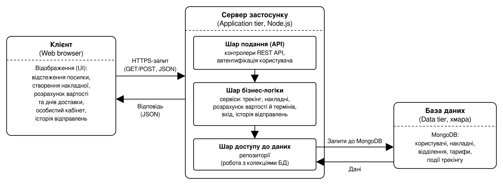
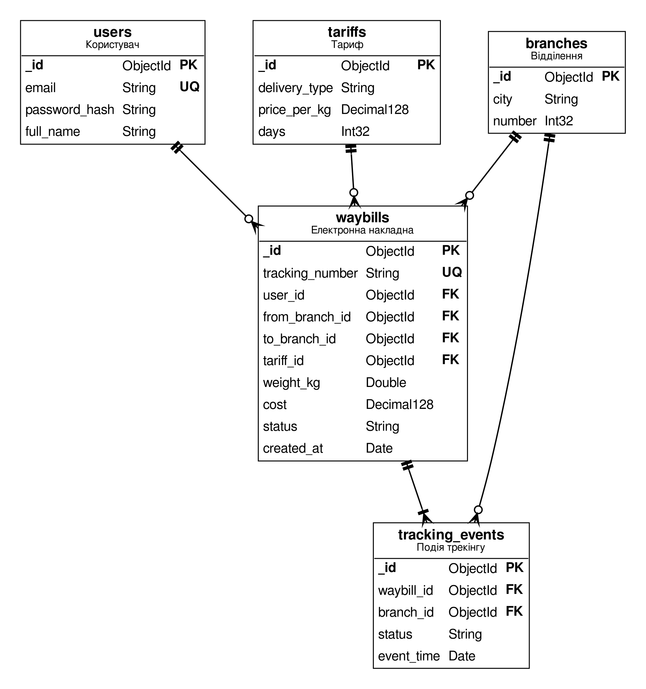
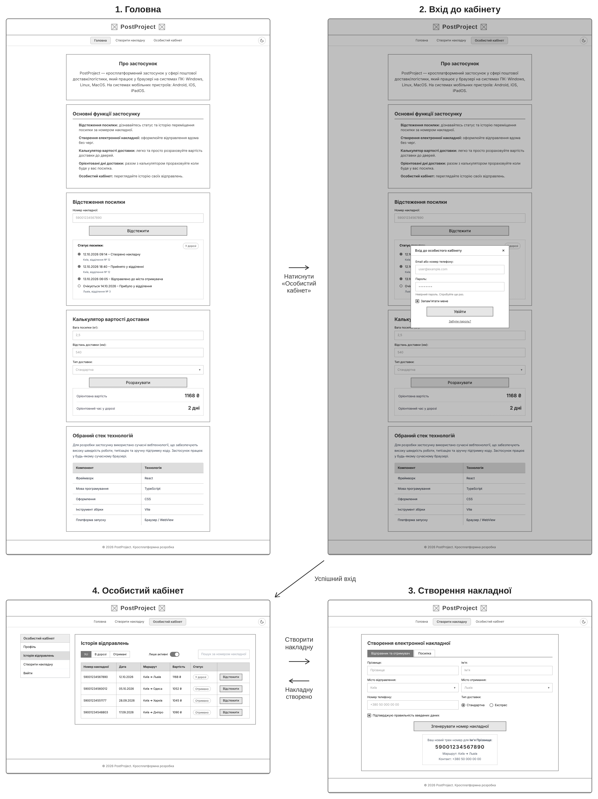
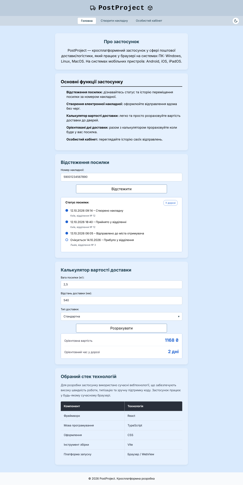

# ТСПП. Лабораторна робота № 3

Результати архітектурного та UX/UI-проєктування веб-застосунку поштової логістики PostProject.

### Архітектурна діаграма

Обрано трирівневу клієнт-серверну архітектуру: браузер, сервер застосунку на Node.js і база даних MongoDB. Сервер поділено на шари подання, бізнес-логіки та доступу до даних.

### ER-діаграма

Модель даних складається з п'яти колекцій: користувачі, відділення, тарифи, накладні та події трекінгу. Центральна колекція — накладні, пов'язані з користувачем, відділеннями й тарифом.

### Каркас (Wireframe)

Каркаси чотирьох екранів без кольорів і стилів: головна сторінка, вхід до кабінету, створення накладної та особистий кабінет. Після успішного входу користувач потрапляє до особистого кабінету, звідки може перейти до створення накладної.

### Компонентна структура

Спільні частини екранів винесено в повторно використовувані компоненти: `Layout` (шапка `Header`, меню `NavBar`, підвал `Footer`), а також `AboutCard` і `TechStackTable` для головної сторінки. Кожен екран підставляє у `Layout` лише власний вміст, що усуває дублювання коду.

### Модальне вікно входу та форма накладної

Модальне вікно входу утримує фокус усередині (focus trap), закривається клавішею Esc або кліком по затемненому фону та повертає фокус на кнопку, що його відкрила. Форма накладної перевіряється за схемою валідації: обов'язкові поля, формат телефону +380XXXXXXXXX, різні міста відправлення та отримання, підтвердження даних. Стан форми зберігається в одному структурованому об'єкті (відправник, отримувач, посилка), а помилки виводяться під відповідними полями.

### Макет (Mockup)

Макет головної сторінки у фірмовому світло-блакитному стилі PostProject. Показує кольори, шрифти та оформлення карток і полів вводу.

